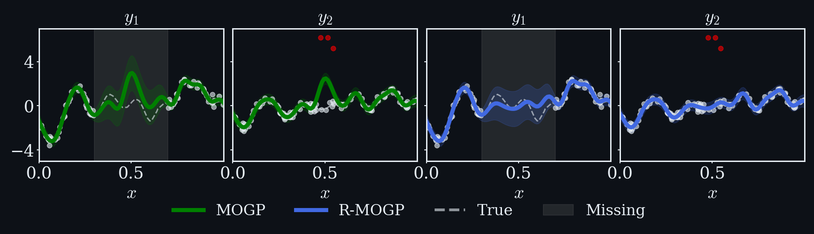

# Outlier-Robust Multi-Output Gaussian Processes

📄 **Paper:** [Outlier-Robust Multi-Output Gaussian Processes](https://arxiv.org/abs/2510.26401) (NeurIPS 2026)<br>
👥 **Authors:** [Joshua Rooijakkers](https://joshuarooijakkers.github.io), [Leiv Rønneberg](https://www.mn.uio.no/math/english/people/aca/ltronneb/), [François-Xavier Briol](https://fxbriol.github.io), [Jeremias Knoblauch](https://jeremiasknoblauch.github.io), [Matias Altamirano](https://maltamiranomontero.github.io)


## Overview

Multi-output Gaussian processes (MOGPs) share information across correlated outputs, but
with a Gaussian likelihood a single outlier can distort the predictions of its own output
and of every output correlated with it. **R-MOGP** replaces the likelihood with a
generalised-Bayes loss based on a weighted score-matching divergence. The posterior stays
Gaussian and available in closed form, at the same cost as a standard MOGP, and it is
provably robust to arbitrarily large outliers in any individual output. A sparse
variational version (**R-SVMOGP**) scales to larger datasets.



Outliers ($\color{#FF0000}\bullet$) in $y_2$ pull the standard $\color{#008000}\text{MOGP}$ away from the
true function (dashed) in $y_2$ and, through the correlation between the outputs, distort its
imputation of $y_1$ in the missing region (shaded). $\color{#4169E1}\text{R-MOGP}$ is unaffected.

## Installation

```bash
git clone https://github.com/joshuarooijakkers/rmogp.git
cd rmogp
pip install -e .                  # package only
pip install -e ".[experiments]"   # package + experiment dependencies
```

## Usage

```python
import numpy as np
from rmogp import RMOGP, ICM, robust_covariance

# X: (N, d) inputs, Y: (N, T) outputs; NaN marks a missing output.

# Robust estimate of the output covariance
A = np.linalg.cholesky(robust_covariance(Y))

# Define the model (epsilons: expected fraction of outliers per output)
model = RMOGP(ICM(A, lengthscale=0.1), noise_var=0.1, mean=np.nanmean(Y, axis=0), epsilons=0.05)

# Optimise the hyperparameters
model.fit(X, Y).optimize()

# Predict: mean and variance, each (N_test, T)
mean, var = model.predict_f(X_test)
```

The package provides:

| Model | Description |
|---|---|
| `MOGP` | Standard exact MOGP with Gaussian noise |
| `RMOGP` | Robust and conjugate MOGP (Proposition 3.1); `weight="rcgp"` gives the naive RCGP weight |
| `SVMOGP`, `RSVMOGP` | Sparse variational (R-)MOGP with inducing points (Proposition 3.3) |
| `ICM`, `LMC`, `ProcessConvolution` | Multi-output kernels |
| `rmogp.baselines.TMOGP`, `LMOGP` | Student-t and Laplace MOGPs in GPflow, used as baselines |

## Reproducing the experiments

Each experiment has a script in [`experiments/`](experiments). Figures are written to
`figures/` and tables to `results/`; run a script with `--help` to see its options.

| Experiment | Script |
|---|---|
| Synthetic imputation | [`synthetic/imputation.py`](experiments/synthetic/imputation.py) |
| Synthetic comparison | [`synthetic/comparison.py`](experiments/synthetic/comparison.py) |
| Navitoclax | [`navitoclax/navitoclax.py`](experiments/navitoclax/navitoclax.py) |
| Energy efficiency | [`energy_efficiency/energy_efficiency.py`](experiments/energy_efficiency/energy_efficiency.py) |
| Electricity load | [`electricity/electricity.py`](experiments/electricity/electricity.py) |

For example:

```bash
python experiments/navitoclax/navitoclax.py
```

The energy-efficiency and electricity data are downloaded on the first run.

## Citation

```bibtex
@inproceedings{rooijakkers2026outlier,
  title     = {Outlier-Robust Multi-Output {G}aussian Processes},
  author    = {Rooijakkers, Joshua and R{\o}nneberg, Leiv and Briol, Fran{\c{c}}ois-Xavier and Knoblauch, Jeremias and Altamirano, Matias},
  booktitle = {Advances in Neural Information Processing Systems},
  year      = {2026},
}
```

## License

MIT; see [LICENSE](LICENSE).
